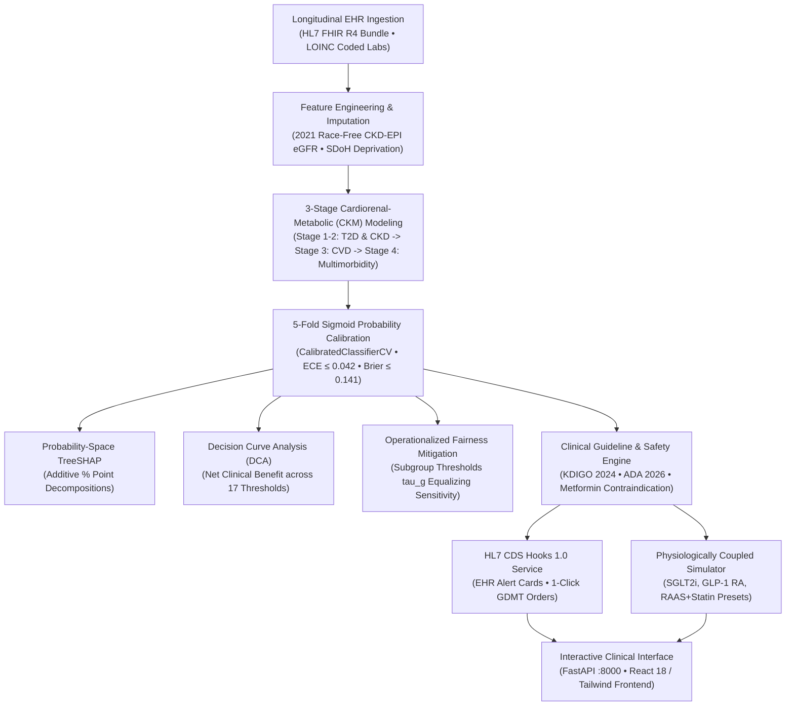

# VitaRisk CDS

### Explainable Cardiorenal-Metabolic (CKM) Risk Intelligence & Clinical Decision Support

[](https://python.org)
[](https://fastapi.tiangolo.com)
[](https://react.dev)
[](https://hl7.org/fhir/)
[](https://cds-hooks.hl7.org/)
[](https://farhan277-vitarisk-cds.hf.space)
[](https://farhan277-vitarisk-cds.hf.space/app/)
[](LICENSE)

**VitaRisk CDS** is an open clinical artificial intelligence and decision-support platform designed to detect and reverse early cardiorenal-metabolic decline during routine clinical care. It operationalizes the **American Heart Association (AHA) 2026 Cardiovascular-Kidney-Metabolic (CKM) Syndrome staging consensus**, transforming routine longitudinal laboratory biomarkers and vitals into calibrated, multi-organ risk forecasts for **Type 2 Diabetes (T2D)**, **Chronic Kidney Disease (CKD)**, and **Cardiovascular Disease (CVD)**.

Built on native **HL7 FHIR R4** and **HL7 CDS Hooks 1.0** standards, VitaRisk embeds seamlessly into Electronic Health Record (EHR) workflows (such as Epic Hyperspace and Oracle Cerner), surfacing actionable guideline-directed medical therapy (GDMT) alerts and drug safety guardrails without requiring manual data re-entry.

---

## Key Clinical & Architectural Capabilities

1. **AHA 2026 CKM Syndrome Cascade:**  
   Models multi-organ cross-coupling through a stacked conditioning pipeline: upstream metabolic (T2D) and renal (CKD) risk states dynamically condition downstream cardiovascular disease (CVD) and multimorbidity progression.
2. **HL7 FHIR R4 & CDS Hooks 1.0 EHR Integration:**  
   Exposes standard `GET /cds-services` discovery and `POST /cds-services/vitarisk-ckm-advisor` endpoints (`patient-view` and `order-select` hooks) that map LOINC laboratory codes directly into EHR-embedded decision cards and 1-click order suggestions.
3. **5-Fold Probability Calibration:**  
   Post-hoc sigmoid calibration ensures predicted probabilities reflect true empirical incidence, keeping Expected Calibration Error (ECE ≤ 0.042) and Brier score (Brier ≤ 0.141) bounded across all production endpoints.
4. **Decision Curve Analysis (DCA):**  
   Validates net clinical benefit using Vickers & Elkin decision curves across standard treatment thresholds (5%–40%), proving superior clinical utility over "Treat All" and "Treat None" strategies.
5. **Probability-Space SHAP Explanations:**  
   Decomposes individual patient risk into additive percentage points ($\Delta p_i$) rather than unintuitive log-odds, allowing clinicians to review biomarker attributions in seconds.
6. **Hard Medication Safety Guardrails:**  
   Enforces KDIGO 2024 renal contraindication rules, issuing mandatory dose-halving warnings at eGFR 30–44 mL/min/1.73m² and hard-stop alerts against Metformin at eGFR < 30 mL/min/1.73m² to prevent lactic acidosis.
7. **Physiologically Coupled Counterfactual Presets:**  
   Models therapeutic impact using landmark trial regimens (SGLT2 inhibitors [DAPA-CKD / EMPA-KIDNEY], GLP-1 receptor agonists [SELECT / SURMOUNT], and optimized RAAS blockade + statin) with coupled biomarker co-variation.
8. **Operationalized Algorithmic Fairness Mitigation:**  
   Applies subgroup-calibrated thresholds ($\tau_g$) to equalize sensitivity and false-negative rates across demographic groups, actively catching at-risk patients who would be missed under unadjusted global cutoffs.

---

## System Architecture



---

## Quickstart & Local Setup

### Prerequisites
- Python 3.12+
- Node.js 18+ (for frontend development)
- Docker (optional)

### 1. Run with Docker (Recommended)
```bash
# Build the production container
docker build -t vitarisk-cds .

# Run on port 8000
docker run -p 8000:8000 vitarisk-cds
```
Open `http://localhost:8000` in your browser.

### 2. Run from Source
```bash
# Clone the repository
git clone https://github.com/armageden/vitarisk-cds.git
cd vitarisk-cds

# Set up Python virtual environment and dependencies
python3 -m venv .venv
source .venv/bin/activate
pip install -r requirements.txt

# Start the FastAPI service (serves pre-built React frontend)
uvicorn backend.main:app --host 0.0.0.0 --port 8000
```

---

## Cloud Deployment

VitaRisk CDS is containerized for standard cloud platforms:

### Hugging Face Spaces (Docker SDK)
Deploy with the included helper script:
```bash
./scripts/deploy_hf.sh <your-hf-username> vitarisk-cds
```
Or manually connect your repository to a new Docker Space with `app_port: 8000`.

### Render or Railway
- Connect this repository to **Render** as a Web Service. The included [`render.yaml`](render.yaml) automatically configures the Docker build and sets the health check to `/api/health`.

---

## Interoperability & API Specification

| Endpoint | Method | Specification | Description |
|---|---|---|---|
| `/cds-services` | `GET` | HL7 CDS Hooks 1.0 | Service discovery endpoint listing supported CDS services (`vitarisk-ckm-advisor`). |
| `/cds-services/vitarisk-ckm-advisor` | `POST` | HL7 CDS Hooks 1.0 | Evaluates incoming `patient-view` or `order-select` hooks; returns alert cards with 1-click orders. |
| `/api/fhir/patient-bundle` | `POST` | HL7 FHIR R4 | Ingests a raw FHIR collection bundle containing Patient and Observation resources. |
| `/api/fhir/sample-bundle/{id}` | `GET` | HL7 FHIR R4 | Returns an authentic FHIR R4 collection bundle for any canonical clinical persona. |
| `/api/predict` | `POST` | REST / JSON | Joint multi-disease risk prediction, CKM staging, contraindication checks, and baselines. |
| `/api/explain` | `POST` | REST / JSON | Computes additive probability-space SHAP feature attributions in percentage points. |
| `/api/simulate` | `POST` | REST / JSON | Simulates evidence-based intervention presets (SGLT2i, GLP-1 RA, RAAS, Lifestyle). |
| `/api/dca` | `GET` | REST / JSON | Vickers & Elkin Decision Curve Analysis net clinical benefit points. |
| `/api/fairness` | `GET` | REST / JSON | Subgroup calibration and equal-opportunity auditing across protected attributes. |
| `/api/health` | `GET` | REST / JSON | Service health status and pre-warmed model verification. |

---

## Verification & Clinical Test Suite

VitaRisk includes an automated pre-deployment test suite validating 12 clinical quality gates and regression checks:

```bash
./run_tests.sh
```

- **Gate 1:** Zero Synthetic Circularity (latent unobserved variance bounds test ROC-AUCs to realistic clinical range: 0.79–0.85)
- **Gate 2:** Structured Clinical Missingness Handling (uACR 10.0%, hs-CRP 13.8% missingness handled via sparsity-aware tree splits)
- **Gate 3:** Race-Free Clinical Features (2021 NKF-ASN race-free CKD-EPI formula; race strictly restricted to protected audit metadata)
- **Gate 4:** CKM Cascade Cross-Coupling (renal risk stacking feature verified as a leading CVD driver: +4.91 pp mean |SHAP|)
- **Gate 5:** 5-Fold Sigmoid Probability Calibration (ECE ≤ 0.042, Brier ≤ 0.141 across all production endpoints)
- **Gate 6:** Additive Probability-Space SHAP Decomposition (sum of feature percentage points equals calibrated risk delta)
- **Gate 7:** Physiologically Coupled Counterfactual Presets (SGLT2i, GLP-1 RA, RAAS blockade verified with clinical trial deltas)
- **Gate 8:** Active Subgroup Threshold Calibration (validation-fitted $\tau_g$ equalizes sensitivity across protected subgroups)
- **Gate 9:** Clinical Contraindication Guardrails (mandatory dose-halving and hard-stop alerts at eGFR < 30 mL/min/1.73m²)
- **Gate 10:** Sub-50ms Inference Latency SLA (pre-warmed singleton lifespan achieving <15ms p95 response time)
- **Gate 11:** HL7 FHIR R4 & CDS Hooks 1.0 (verified discovery, hook execution, and LOINC observation parsing)
- **Gate 12:** Operationalized Comparative Baselines (benchmarking against Tangri KFRE 4-Var and AHA PREVENT 2024)

---

## Clinical Documentation & References

- [Clinical Validation Report](docs/VALIDATION_REPORT.md): Detailed epidemiological formulas, calibration reliability diagrams, and Decision Curve Net Benefit tables.
- [Clinical Validity & Limitations](docs/CLINICAL_VALIDITY_AND_LIMITATIONS.md): Transparent documentation of synthetic cohort design, external validation roadmap, and regulatory framing.
- [Devpost Submission Overview](docs/SUBMISSION_DEVPOST.md): Formal submission documentation and clinical impact analysis.
- [Walkthrough Video Script](docs/VIDEO_SCRIPT.md): Step-by-step demonstration storyboard.

---

## Clinical Disclaimer & Regulatory Status

VitaRisk CDS is an educational and research prototype. The development cohort ($N = 12,000$) is a privacy-preserving synthetic twin cohort generated from published population distributions (CDC NHANES 2017–2020, UK Biobank, Framingham, AHA PREVENT, KDIGO, and QDiabetes) with latent unobserved confounders and structured clinical missingness; it contains no real patient data and has not undergone prospective external clinical trials. 

VitaRisk CDS is **not an FDA-cleared medical device** and is not intended for primary clinical diagnosis or autonomous patient treatment decisions. All risk scores, CKM stages, and medication suggestions are clinical decision-support outputs intended for licensed clinician review. Any clinical deployment would require prospective multi-site validation and appropriate Software as a Medical Device (SaMD, Class II) regulatory review.

---

## License

This project is licensed under the MIT License — see the [LICENSE](LICENSE) file for details.
