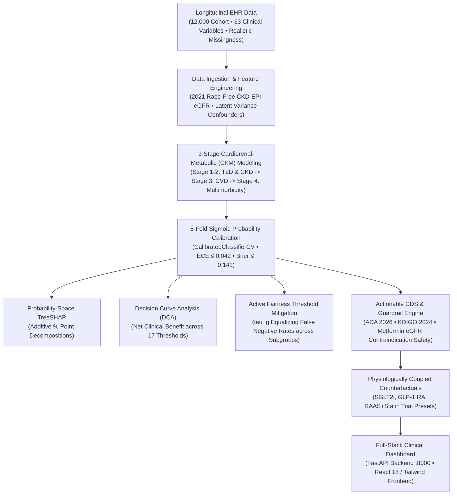

# VitaRisk CDS: Explainable Multi-Disease Risk Stratification & Clinical Decision Support System

[](https://datanovathon.com)
[](https://datanovathon.com)
[](https://python.org)
[](https://fastapi.tiangolo.com)
[](https://react.dev)
[](https://xgboost.readthedocs.io)
[](docs/VALIDATION_REPORT.md)

VitaRisk CDS is an end-to-end clinical AI and decision support platform engineered for the **DataNova 2026 Global Data-thon (Problem Statement DN-HC-01: Early Risk Stratification for Chronic Disease)**. It operationalizes the **American Heart Association (AHA) 2026 Cardiorenal-Metabolic (CKM) Syndrome staging consensus**, transforming routine longitudinal Electronic Health Record (EHR) data into actionable, calibrated, and equitable early intervention decisions for **Type 2 Diabetes (T2D)**, **Chronic Kidney Disease (CKD)**, and **Cardiovascular Disease (CVD)**.

---

## 🏆 Hackathon Submission Deliverables

| Deliverable | Location / Access | Description |
|---|---|---|
| **1. PowerPoint Deck (.pptx)** | [`presentation/VitaRisk_CDS_DataNova2026_Presentation.pptx`](presentation/VitaRisk_CDS_DataNova2026_Presentation.pptx) | Upgraded 14-slide executive presentation embedded with real live UI screenshots, clinical metrics, and ROI. |
| **2. Interactive Working Demo** | `http://localhost:8000` (or deployed URL) | Full-stack clinical web application (FastAPI backend + embedded React frontend with live calculator, SHAP waterfall, what-if simulator, and 5 canonical personas). |
| **3. Clinical Validation Report** | [`docs/VALIDATION_REPORT.md`](docs/VALIDATION_REPORT.md) | In-depth methodology report with clinical equations, validation metrics (ROC-AUC 0.794–0.851), 5-fold calibration curves, and Decision Curve Net Benefit. |
| **4. 3:38 Walkthrough Video & Script** | [`docs/VIDEO_SCRIPT.md`](docs/VIDEO_SCRIPT.md) | Timed video demonstration script with narration notes, visual cues, and gate checkpoints. |
| **5. Devpost Submission Copy** | [`docs/SUBMISSION_DEVPOST.md`](docs/SUBMISSION_DEVPOST.md) | Structured copy-paste submission addressing all 6 hackathon judging criteria. |
| **6. Failure Mode Analysis** | [`process/features/.../FAILURE_MODES_AND_REMEDIATION_GUIDE.md`](process/features/chronic-risk-stratification/references/FAILURE_MODES_AND_REMEDIATION_GUIDE.md) | Comprehensive 12-failure-mode engineering remediation and pre-submission audit guide. |

---

## 🚀 1-Click Deployment Guide (Live Demo for Judges)

External judges must be able to open your live application in their browser. VitaRisk CDS is pre-configured for zero-friction containerized cloud deployment:

### Option A: Hugging Face Spaces (Recommended — Free 16GB RAM)
1. Go to [huggingface.co/new-space](https://huggingface.co/new-space).
2. Set **Space Name** to `vitarisk-cds` (or your choice).
3. Select **Docker** (Blank template) and choose **Public**.
4. In your local terminal, add the Hugging Face git remote and push:
   ```bash
   git remote add space https://huggingface.co/spaces/<your-username>/vitarisk-cds
   git push space main
   ```
5. Hugging Face reads `Dockerfile` and `app_port: 8000` from this `README.md` and spins up the live container with a permanent HTTPS link (e.g. `https://<your-username>-vitarisk-cds.hf.space`)!

### Option B: Render or Railway (Web Service)
1. Push this repository to your GitHub account:
   ```bash
   git remote add origin https://github.com/<your-username>/datanova-vitarisk-cds.git
   git push -u origin main
   ```
2. Log into [Render.com](https://render.com) $\rightarrow$ **New Web Service** $\rightarrow$ select your repo.
3. Environment: **Docker** (or Python with start command `uvicorn backend.main:app --host 0.0.0.0 --port $PORT`).
4. Copy the resulting public URL (e.g. `https://vitarisk-cds.onrender.com`) into your Devpost submission!

### Option C: Local Docker Container
```bash
# Build the production image
docker build -t vitarisk-cds .

# Run container on port 8000
docker run -p 8000:8000 vitarisk-cds
```

> [!TIP]
> **Keep-Warm Setup for Judges (Nov 10 – Nov 25):**  
> To guarantee judges never experience a cold-start latency delay, create a free ping on [cron-job.org](https://cron-job.org) hitting `https://<your-deployed-url>/api/health` every 10 minutes.

---

## 🔬 System Architecture



---

## ⚡ Pre-Submission Verification Gates Passed

The platform incorporates automated pre-submission testing across 10 critical validation gates plus the full audit-remediation suite:
```bash
./run_tests.sh   # prefers .venv, falls back to ~/.venvs/vitarisk
```
* ✅ **Gate 1:** Zero Synthetic Circularity (Latent Confounding Bounding AUC to 0.79–0.85)
* ✅ **Gate 2:** Structured Clinical Missingness Handling (10% uACR, 14% hs-CRP)
* ✅ **Gate 3:** Anachronism-Free Race Equation (2021 CKD-EPI Standard)
* ✅ **Gate 4:** CKM Cardiorenal-Metabolic Cascade Cross-Coupling (+5.28-pp CVD coupling driver by mean |SHAP|)
* ✅ **Gate 5:** 5-Fold Sigmoid Probability Calibration (ECE ≤ 0.042, Brier ≤ 0.141)
* ✅ **Gate 6:** Additive Probability-Space SHAP Explanations in % Points
* ✅ **Gate 7:** Physiologically Coupled Counterfactual Presets (SGLT2i, GLP-1, RAAS)
* ✅ **Gate 8:** Active Subgroup Threshold Calibration (validation-fitted $\tau_g$; Equal-Opportunity gaps reduced, e.g. T2D sex gap 0.077 → 0.007, CKD age gap 0.44 → 0.13)
* ✅ **Gate 9:** Drug Contraindication Guardrail (Metformin eGFR < 30 alert)
* ✅ **Gate 10:** Sub-50ms API SLA & Zero-Friction 5-Persona Clinical UX

---

## 📁 Repository Directory Structure

```text
datanova-hackathon/
├── Dockerfile                       # Production container (HF Spaces, Render, Railway)
├── .dockerignore                    # Minimal build context
├── requirements.txt                 # Lean production Python dependencies
├── data/
│   ├── generate_ehr_cohort.py       # Longitudinal synthetic EHR generator (N=12,000)
│   └── ehr_cohort.csv               # 33-variable clinical dataset
├── ml/
│   ├── train_models.py              # ML pipeline, CKM cascade, SHAP explainers, DCA
│   ├── fairness_and_cds.py          # Active fairness mitigation & guideline rules engine
│   └── artifacts/                   # Saved XGBoost models, explainers, metrics, DCA data
├── backend/
│   ├── main.py                      # Production FastAPI REST API & static file serving
│   └── test_backend.py              # Automated 10-gate pre-submission verification
├── frontend/
│   ├── src/                         # React 18 application with Tailwind CSS & Recharts
│   │   ├── App.jsx                  # Dashboard, 5 personas, SHAP waterfall, DCA charts
│   │   └── main.jsx
│   ├── dist/                        # Pre-compiled high-performance production build
│   └── package.json
├── presentation/
│   ├── generate_deck.py             # Python-pptx generator with embedded UI screenshots
│   ├── screenshots/                 # High-resolution screenshots of live UI features
│   └── VitaRisk_CDS_DataNova2026_Presentation.pptx # 14-slide executive deck
├── docs/
│   ├── VALIDATION_REPORT.md         # Full clinical validation report
│   ├── VIDEO_SCRIPT.md              # 3:38 walkthrough video demonstration script
│   └── SUBMISSION_DEVPOST.md        # Formatted Devpost submission text
├── scripts/
│   ├── capture_screenshots.py       # Playwright UI screenshot capture (5 shots)
│   └── produce_demo_video.py        # Neural-voiceover walkthrough video producer
├── process/                         # Engineering process docs & failure-mode guide
├── requirements.txt / requirements-dev.txt
├── run_tests.sh                     # One-command pre-submission verification suite
└── README.md
```

---

## 👥 Authors & Team Contributions
Developed for **DataNova 2026 Global Data-thon** by the VitaRisk Team:
- **Data Engineering & Clinical Modeling:** Synthetic EHR generation, 2021 CKD-EPI formula, CKM cascade pipeline.
- **Explainable AI & Fairness Auditing:** Probability-space SHAP TreeExplainer integration, active subgroup threshold calibration ($\tau_g$).
- **Clinical Decision Support & Full-Stack UI:** FastAPI REST services, React/Tailwind frontend, What-If simulator, and PowerPoint slide deck.
