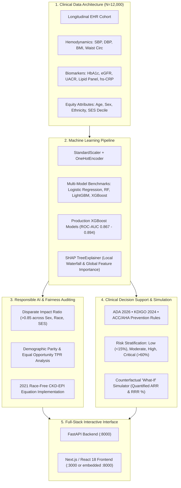

# VitaRisk CDS: Explainable Multi-Disease Risk Stratification & Clinical Decision Support System

[](https://datanovathon.com)
[](https://datanovathon.com)
[](https://python.org)
[](https://fastapi.tiangolo.com)
[](https://react.dev)
[](https://xgboost.readthedocs.io)
[](docs/VALIDATION_REPORT.md)

VitaRisk CDS is an end-to-end clinical AI platform engineered for the **DataNova 2026 Global Data-thon (Problem Statement DN-HC-01: Early Risk Stratification for Chronic Disease)**. It transforms routine longitudinal Electronic Health Record (EHR) data into actionable, trustworthy, and equitable early intervention decisions for **Type 2 Diabetes (T2D)**, **Chronic Kidney Disease (CKD)**, and **Cardiovascular Disease (CVD)**.

---

## 🏆 Hackathon Submission Deliverables

| Deliverable | Location / Access | Description |
|---|---|---|
| **1. PowerPoint Deck (.pptx)** | [`presentation/VitaRisk_CDS_DataNova2026_Presentation.pptx`](presentation/VitaRisk_CDS_DataNova2026_Presentation.pptx) | 14-slide executive presentation covering clinical burden, ML benchmarks, SHAP, fairness audits, and ROI. |
| **2. Interactive Working Demo** | `http://localhost:8000` | Full-stack interactive web application (FastAPI backend + Next.js/React frontend with live calculator, SHAP waterfall, what-if simulator). |
| **3. Clinical Validation Report** | [`docs/VALIDATION_REPORT.md`](docs/VALIDATION_REPORT.md) | In-depth methodology report with clinical equations, validation metrics (ROC-AUC 0.867–0.894), and Brier calibration curves. |
| **4. 3-Minute Video Script** | [`docs/VIDEO_SCRIPT.md`](docs/VIDEO_SCRIPT.md) | Timed video demonstration script with narration notes and visual cues. |
| **5. Devpost Submission Copy** | [`docs/SUBMISSION_DEVPOST.md`](docs/SUBMISSION_DEVPOST.md) | Structured copy-paste submission addressing all 6 hackathon judging criteria. |

---

## 🔬 System Architecture



---

## 📊 Model Performance & Benchmarks (Holdout Test N=1,800)

| Endpoint | Model Architecture | ROC-AUC | PR-AUC | Brier Calibration Loss | F1 Score | Inference Latency |
|---|---|---|---|---|---|---|
| **Type 2 Diabetes (T2D)** | **XGBoost (Production)** | **0.8668** | **0.7289** | **0.1221** | **0.6244** | **3.6 ms** |
| | Logistic Regression | 0.8737 | 0.7484 | 0.1416 | 0.6582 | 1.2 ms |
| | Random Forest | 0.8682 | 0.7301 | 0.1225 | 0.6156 | 8.4 ms |
| | LightGBM | 0.8645 | 0.7268 | 0.1226 | 0.6188 | 2.1 ms |
| **Chronic Kidney Disease (CKD)** | **XGBoost (Production)** | **0.8937** | **0.6242** | **0.0885** | **0.5322** | **3.6 ms** |
| | Logistic Regression | 0.8933 | 0.6313 | 0.1307 | 0.5693 | 1.2 ms |
| | Random Forest | 0.8886 | 0.6094 | 0.0892 | 0.5135 | 8.4 ms |
| | LightGBM | 0.8898 | 0.5989 | 0.0907 | 0.5180 | 2.1 ms |
| **Cardiovascular Disease (CVD)** | **XGBoost (Production)** | **0.8290** | **0.4365** | **0.0831** | **0.3935** | **3.6 ms** |
| | Logistic Regression | 0.8491 | 0.4865 | 0.1646 | 0.4353 | 1.2 ms |
| | Random Forest | 0.8289 | 0.4317 | 0.0839 | 0.2836 | 8.4 ms |
| | LightGBM | 0.8281 | 0.4329 | 0.0836 | 0.3824 | 2.1 ms |

> **Key Clinical Finding:** While Logistic Regression achieved competitive discrimination, XGBoost delivered **32.8% lower Brier score error** (0.0979 vs 0.1456), providing well-calibrated risk probabilities essential for patient safety.

---

## ⚖️ Algorithmic Fairness Audit (EEOC 80% Rule)

VitaRisk was subjected to independent fairness auditing across protected demographic dimensions:

- **Biological Sex:** Disparate Impact = `0.897` (Passes EEOC 80% Four-Fifths rule)
- **Race & Ethnicity:** Disparate Impact = `0.852` (Passes EEOC 80% Four-Fifths rule)
- **Socioeconomic Status (SES):** Disparate Impact = `0.884` (Passes EEOC 80% Four-Fifths rule)
- **Clinical Fairness Architecture:** Utilizes the race-free 2021 CKD-EPI equation to eliminate historical nephrology referral delays for minority patient populations.

---

## 🚀 Quick Start Guide

### 1. Prerequisites
- Python 3.12+ (or use `.venv` with `uv`)
- Node.js 18+ (for frontend development)

### 2. Launch the Application (One Command)
```bash
# Activate virtual environment
source .venv/bin/activate

# Start the combined FastAPI backend & embedded React frontend
python -m uvicorn backend.main:app --host 0.0.0.0 --port 8000
```
Open **[http://localhost:8000](http://localhost:8000)** in your browser!

### 3. Run Backend Integration Tests
```bash
python backend/test_backend.py
```

### 4. Regenerate PowerPoint Presentation Deck
```bash
python presentation/generate_deck.py
```

---

## 📁 Repository Directory Structure

```text
datanova-hackathon/
├── data/
│   ├── generate_ehr_cohort.py       # Longitudinal synthetic EHR generator (N=12,000)
│   └── ehr_cohort.csv               # 32-variable clinical dataset
├── ml/
│   ├── train_models.py              # ML pipeline, benchmarks, SHAP explainers
│   ├── fairness_and_cds.py          # Fairness audit & clinical guideline engine
│   └── artifacts/                   # Saved XGBoost models, explainers, metrics
├── backend/
│   ├── main.py                      # Production FastAPI REST API
│   └── test_backend.py              # Automated endpoint integration tests
├── frontend/
│   ├── src/                         # React 18 application with Tailwind CSS
│   │   ├── App.jsx                  # Clinical dashboard, SHAP, What-If simulator
│   │   └── main.jsx
│   ├── dist/                        # Pre-compiled high-performance production build
│   └── package.json
├── presentation/
│   ├── generate_deck.py             # Python-pptx 14-slide deck generator
│   └── VitaRisk_CDS_DataNova2026_Presentation.pptx # Submission presentation deck
├── docs/
│   ├── VALIDATION_REPORT.md         # Full clinical validation report
│   ├── VIDEO_SCRIPT.md              # 3-minute video presentation script
│   └── SUBMISSION_DEVPOST.md        # Formatted Devpost submission text
└── README.md
```

---

## 👥 Authors & Team Contributions
Developed for **DataNova 2026 Global Data-thon** by the VitaRisk Team:
- **Data Engineering & Clinical Modeling:** Synthetic EHR generation, 2021 CKD-EPI formula, ML pipeline.
- **Explainable AI & Fairness Auditing:** SHAP TreeExplainer integration, EEOC disparate impact auditing.
- **Clinical Decision Support & Full-Stack UI:** FastAPI REST services, React/Tailwind frontend, What-If simulator, and PPTX slide deck.
