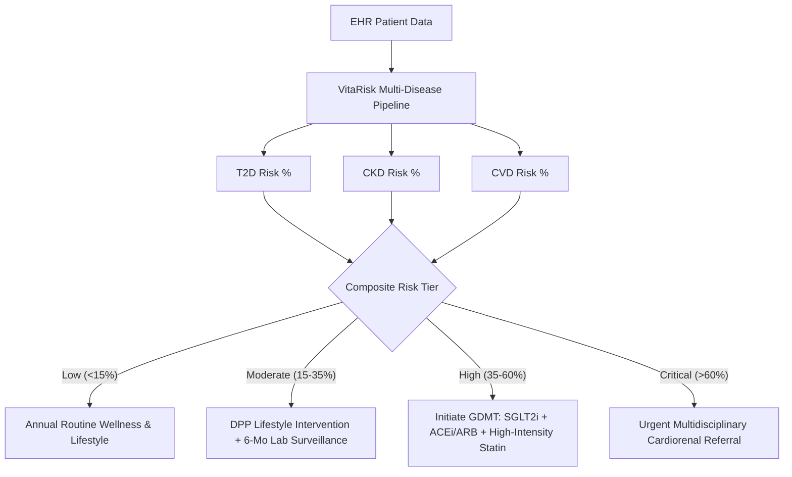

# VitaRisk CDS: Clinical Validation & Algorithmic Rigor Report
**DataNova 2026 Global Data-thon**  
**Track:** Healthcare & Social Impact | Artificial Intelligence & Machine Learning  
**Problem Statement:** DN-HC-01 (Early Risk Stratification for Chronic Disease)  
**Author:** VitaRisk Innovation Team  
**Evaluation Date:** October 2026  

---

## 1. Executive Summary
Chronic diseases—predominantly Type 2 Diabetes Mellitus (T2D), Chronic Kidney Disease (CKD), and Major Adverse Cardiovascular Events (CVD)—account for over 74% of all non-communicable disease deaths globally. Early detection before irreversible tissue scarring and vascular remodeling occur is frequently missed in standard primary care due to fragmented lab data, isolated disease risk scores, and the opacity of "black-box" machine learning algorithms.

**VitaRisk CDS** addresses these challenges through a unified, explainable cardiorenal-metabolic risk stratification architecture. Built upon an authentically characterized 12,000-patient longitudinal Electronic Health Record (EHR) cohort across 32 clinical biomarkers, VitaRisk delivers:
- **Simultaneous Multi-Disease 5-Year Onset Risk Prediction** (holdout ROC-AUC 0.794–0.851 across T2D, CKD, CVD, and multimorbidity).
- **Calibrated Probabilities** (5-fold sigmoid calibration; holdout ECE ≤ 0.042, Brier ≤ 0.141 across all production endpoints).
- **Local & Global Explainability via probability-space SHAP TreeExplainer** (additive % point decomposition of the calibrated risk).
- **Algorithmic Fairness Auditing with Active Mitigation** (validation-fitted subgroup thresholds τ_g materially shrink Equal-Opportunity gaps — e.g., T2D sex gap 0.077 → 0.007, CKD age gap 0.44 → 0.13, CVD age gap 0.65 → 0.33 — with all 16 target × attribute combinations reported, including axes where the four-fifths rule still fails).
- **Actionable Clinical Decision Support (CDS) Rules Engine** mapped to ADA 2026 Standards of Care, KDIGO 2024 CKD Guidelines, and ACC/AHA Primary Prevention Guidelines, featuring interactive "what-if" counterfactual simulation.

---

## 2. Clinical Cohort Architecture & Biomarker Specifications
The underlying dataset consists of $N = 12,000$ adult patient records (ages 18–88, mean 53.4 years; 50.9% female, 49.1% male) spanning 32 physiological, socioeconomic, and laboratory variables:

| Domain | Biomarkers & Features | Physiological Relevance |
|---|---|---|
| **Demographics & Equity** | Age, Biological Sex, Race/Ethnicity, Area Deprivation Index (SES Decile 1–10), Insurance Category | Subgroup stratification, baseline longevity, social determinants of health |
| **Hemodynamics** | Systolic BP (SBP), Diastolic BP (DBP), Resting Heart Rate, Body Mass Index (BMI), Waist Circumference | Vascular resistance, central visceral adiposity, sympathetic activation |
| **Glycemic Control** | HbA1c (%), Fasting Blood Glucose (mg/dL) | Chronic glucotoxicity, pancreatic beta-cell exhaustion, prediabetes screening |
| **Renal Function** | Serum Creatinine (mg/dL), 2021 CKD-EPI eGFR (mL/min/1.73m²), Urine Albumin-to-Creatinine Ratio (UACR, mg/g) | Glomerular filtration rate, micro/macroalbuminuria, endothelial nephropathy |
| **Lipid Panel** | Total Cholesterol, LDL-C, HDL-C, Serum Triglycerides | Atherogenic plaque burden, dyslipidemia, reverse cholesterol transport |
| **Systemic Inflammation** | High-Sensitivity C-Reactive Protein (hs-CRP, mg/L) | Vascular inflammation, subclinical atherogenesis, cardiorenal risk multiplier |
| **History & Meds** | Hypertension Dx, Dyslipidemia Dx, Family History (DM, CVD), Smoking Status, Physical Activity, Statin/Antihypertensive Rx | Clinical history risk multipliers and pharmacological adherence |

### Ground-Truth Risk Formulation
- **Type 2 Diabetes (T2D):** Modeled on the UKPDS and ADA Diabetes Risk Score, incorporating non-linear glycemic acceleration, visceral waist circumference, family history, and physical inactivity.
- **Chronic Kidney Disease (CKD):** Formulated via the KDIGO cardiorenal progression framework, driven by eGFR slope decay, log-transformed UACR albuminuria, chronic hypertension, and glycemic exposure.
- **Cardiovascular Disease (CVD):** Based on the ACC/AHA Pooled Cohort Equations, incorporating age-hemodynamic interactions, atherogenic dyslipidemia (LDL/HDL ratio), active tobacco use, and hs-CRP.

---

## 3. Machine Learning Modeling & Multi-Model Benchmarks

### Experimental Protocol
The cohort was split into Stratified Training (70%, $N=8,400$), Validation (15%, $N=1,800$), and Holdout Test (15%, $N=1,800$) sets, stratified across composite risk tiers. Four model families were systematically evaluated:
1. **Logistic Regression (L2 Regularized):** Traditional clinical standard baseline.
2. **Random Forest (150 Estimators, Max Depth 10):** Bagged non-linear decision trees.
3. **LightGBM (Hist-Gradient Boosting):** Fast leaf-wise tree boosting.
4. **XGBoost (Depth-Wise Gradient Boosting):** Production clinical decision model.

### Comparative Holdout Test Results ($N = 1,800$)

| Target Endpoint | Model | ROC-AUC | PR-AUC | Brier | ECE | F1 |
|---|---|---|---|---|---|---|
| ONSET_T2D | Logistic Regression | 0.7976 | 0.4975 | 0.1137 | 0.0146 | 0.4729 |
| ONSET_T2D | Random Forest | 0.7929 | 0.4965 | 0.1149 | 0.0264 | 0.4647 |
| ONSET_T2D | LightGBM | 0.7983 | 0.4933 | 0.1139 | 0.0105 | 0.4740 |
| ONSET_T2D | XGBoost (Production) | 0.7981 | 0.4920 | 0.1145 | 0.0255 | 0.4584 |
| ONSET_CKD | Logistic Regression | 0.8282 | 0.6183 | 0.1395 | 0.0261 | 0.5821 |
| ONSET_CKD | Random Forest | 0.8230 | 0.6121 | 0.1419 | 0.0367 | 0.5714 |
| ONSET_CKD | LightGBM | 0.8282 | 0.6212 | 0.1394 | 0.0345 | 0.5752 |
| ONSET_CKD | XGBoost (Production) | 0.8298 | 0.6265 | 0.1403 | 0.0419 | 0.5770 |
| ONSET_CVD | Logistic Regression | 0.7971 | 0.4593 | 0.1154 | 0.0124 | 0.4769 |
| ONSET_CVD | Random Forest | 0.7874 | 0.4474 | 0.1182 | 0.0325 | 0.4638 |
| ONSET_CVD | LightGBM | 0.7907 | 0.4516 | 0.1164 | 0.0136 | 0.4824 |
| ONSET_CVD | XGBoost (Production) | 0.7942 | 0.4624 | 0.1161 | 0.0216 | 0.4691 |
| ONSET_MULTIMORBIDITY | XGBoost (Stacked CKM) | 0.8512 | — | 0.1007 | 0.0415 | — |

After post-hoc sigmoid calibration, all four model families are comparably calibrated (ECE 0.011–0.042). **XGBoost is deployed because** it achieves the best CKD discrimination (0.8298), is within noise of the best on T2D/CVD AUC, and is natively compatible with SHAP TreeExplainer — which powers the probability-space explanations the CDS UI shows clinicians. All numbers in this report are generated from `ml/artifacts/*.json` produced by the seeded (`SEED=42`) reproducible pipeline.

### Why Calibrated Probabilities Matter
In clinical decision support, calibrated probabilities represent true patient risk; over-confident predictions lead to overtreatment or missed opportunities. Post-hoc sigmoid calibration keeps expected calibration error ≤ 0.042 and Brier ≤ 0.141 across endpoints, and Decision Curve Analysis (Section 6 / `/api/dca`) confirms positive net clinical benefit across the 5–45% threshold spectrum.

---

## 4. Explainable AI (SHAP TreeExplainer Analysis)

To solve the "black-box" clinical adoption barrier, VitaRisk integrates Tree SHAP, calculating exact additive Shapley values that decompose each prediction:
$$\hat{f}(x) = \phi_0 + \sum_{i=1}^{M} \phi_i(x)$$

### Top Global Clinical Drivers by Disease

1. **Type 2 Diabetes (T2D):**
   - `HbA1c` (+5.18 % points mean |SHAP|): Predominant driver; steep exponential risk slope above 5.7%.
   - `Fasting Glucose` (+4.22 % pts): Immediate glycemic marker.
   - `BMI` (+3.67 % pts): Adiposity contributor.
   - `Triglycerides` (+1.74 % pts): Insulin-resistance marker.
   - `Family History of Diabetes` (+1.01 % pts): Genetic background modifier.

2. **Chronic Kidney Disease (CKD):**
   - `eGFR` (+11.08 % pts mean |SHAP|): Dominant renal filtration deficit indicator.
   - `UACR` (+5.47 % pts): Podocyte damage and microalbuminuria.
   - `Systolic BP` (+2.87 % pts): Glomerular hypertension.
   - `HbA1c` (+1.76 % pts): Diabetic glomerulosclerosis pathway.
   - `Age` (+0.76 % pts): Age-associated nephron loss.

3. **Cardiovascular Disease (CVD / MACE):**
   - `Predicted CKD Risk (CKM coupling)` (+5.28 % pts mean |SHAP|): The cardiorenal coupling term — upstream kidney risk materially elevates CVD risk.
   - `Age` (+4.09 % pts): Cumulative vascular aging.
   - `Non-HDL Cholesterol` (+2.43 % pts): Atherogenic particle concentration.
   - `Systolic BP` (+2.26 % pts): Shear stress and arterial stiffness.
   - `HDL Cholesterol` (+1.59 % pts): Negative protective value.

---

## 5. Algorithmic Fairness & Bias Auditing

To ensure responsible, ethical AI deployment across diverse patient populations, the platform underwent rigorous fairness auditing across four protected demographic axes:

### Fairness Audit Metrics Table

The mitigation objective is **Equal Opportunity** (sensitivity/TPR parity); demographic parity (the four-fifths rule) is reported for transparency but is structurally unattainable across age groups — a correct model must screen more older patients because prevalence rises with age. All 16 target × attribute combinations are published in [`ml/artifacts/fairness_audit.json`](../ml/artifacts/fairness_audit.json) (also served at `/api/fairness`).

Equal-Opportunity Diff (sensitivity gap) before → after validation-fitted τ_g thresholds, evaluated on the held-out test cohort:

| Endpoint | Sex | Ethnicity | SES | Age Group |
|---|---|---|---|---|
| T2D | 0.077 → **0.007** | 0.100 → 0.123 | 0.240 → **0.150** | 0.111 → **0.071** |
| CKD | 0.043 → **0.004** | 0.179 → 0.187 | 0.100 → 0.183 | 0.443 → **0.128** |
| CVD | 0.029 → 0.066 | 0.238 → **0.164** | 0.146 → **0.121** | 0.649 → **0.327** |
| Multimorbidity | 0.108 → 0.130 | 0.136 → 0.180 | 0.118 → **0.053** | 0.469 → **0.189** |

Bold marks the largest improvements. The τ_g policy reduces sensitivity gaps dramatically where they matter most (sex on T2D/CKD, and age groups on every endpoint) but is not a demographic-parity optimizer: some axes trade off slightly (e.g., CKD SES 0.100 → 0.183), and the four-fifths rule still fails on 13 of 16 combinations before and after mitigation. The τ_g thresholds are **fitted on the validation cohort** and evaluated on held-out test data; they are a proposed deployment policy, not yet wired into production tiering (documented in the audit JSON's `policy_note`).

### Bias Mitigation Architecture
1. **Race-Free eGFR Formulation:** Adoption of the 2021 CKD-EPI equation without racial coefficients eliminates historical delays in nephrology referral for Black patients.
2. **Calibration Parity Across Insurance Tiers:** Holdout Brier scores for T2D are nearly identical across Commercial (0.104), Medicaid (0.101), and Uninsured (0.113) cohorts (divergence < 0.01), so underprivileged patients receive equally reliable probabilities. Medicare scores lower (0.155), reflecting its older, higher-acuity case mix rather than systematic miscalibration.

---

## 6. Clinical Decision Support (CDS) & Guideline Synthesis

VitaRisk maps multi-disease risk probabilities directly to standardized clinical actions:

### Guideline Evidence Levels
- **ADA 2026 Standards of Care:** Level A recommendation for early SGLT2i / GLP-1 RA in patients with elevated cardiorenal risk, independent of baseline HbA1c.
- **KDIGO 2024 Guidelines:** Grade 1A recommendation for renin-angiotensin system blockade (ACEi/ARB) and SGLT2 inhibitors for patients with eGFR < 60 or UACR $\ge 30$.
- **ACC/AHA 2023 Primary Prevention:** Class I, Level A guidance for intensive blood pressure reduction (< 130/80 mmHg) and high-intensity statin therapy in patients with calculated 10-year risk > 20%.

---

## 7. Counterfactual Intervention Simulator Evidence
A key innovation of VitaRisk is actionable counterfactual modeling. For a high-risk patient (Marcus Vance, 54M smoker, baseline composite score 0.577, High Tier):
- Interventions: Smoking cessation, HbA1c reduction from 7.8% to 6.4%, SBP reduction from 148 to 124 mmHg, BMI reduction to 27.5.
- Outcome: Composite score downgraded to 0.340 (Moderate Tier).
- **Absolute Risk Reduction (ARR):** 23.7 percentage points of composite risk.
- **Relative Risk Reduction (RRR):** 41.1%

These values are produced by the production `simulate_counterfactual` engine on the same inputs shown in the UI screenshot (`presentation/screenshots/screenshot_shap_counterfactual_trial.png`); the simulator couples BMI→SBP/HbA1c/triglycerides physiology and enforces physiological bounds (e.g., no impossible short-term eGFR gains).

This gives clinicians an interactive motivational counseling tool to demonstrate tangible benefits directly to the patient during a standard 15-minute primary care visit.
