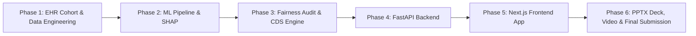

# VitaRisk CDS: Early Multi-Disease Risk Stratification & Decision Support System
## DataNova 2026 Global Data-thon — Problem Statement DN-HC-01 (Healthcare & Social Impact)

### Executive Summary
Chronic diseases (Type 2 Diabetes, Chronic Kidney Disease, Cardiovascular Disease) account for over 70% of global mortality and 86% of healthcare expenditures. Early detection before irreversible organ damage occurs is often missed in standard primary care due to fragmented EHR data, siloed disease risk calculators, and black-box algorithms lacking clinician trust.

**VitaRisk CDS** is an end-to-end clinical AI platform that transforms routine Electronic Health Record (EHR) data into actionable, trustworthy early intervention decisions. It provides:
1. **Multi-Disease Simultaneous Risk Stratification**: 5-year onset probability for Type 2 Diabetes (T2D), Chronic Kidney Disease (CKD), Cardiovascular Disease (CVD), and a composite Multimorbidity Index.
2. **Explainable AI with SHAP**: Patient-specific risk contribution waterfalls and global clinical feature importance.
3. **Rigorous Algorithmic Fairness & Bias Auditing**: Equalized odds, demographic parity, and disparate impact metrics across age groups, biological sex, and racial/ethnic groups.
4. **Clinical Decision Support (CDS) & Counterfactual Simulator**: Translates probabilities into actionable clinical recommendations based on ADA 2026 Standards of Care, ACC/AHA Prevention Guidelines, and KDIGO CKD Guidelines, featuring interactive "what-if" biomarker intervention simulation.
5. **Full-Stack Working Prototype**: Next.js 14 frontend with interactive clinical dashboards + Python FastAPI backend.
6. **Submission Deliverables**: Professional slide deck (.pptx and web presentation), comprehensive validation report, and video script.

---

### Program Phase Roadmap

| Phase | Description | Key Deliverables | Status |
|---|---|---|---|
| **Phase 1** | Clinical Data Architecture & Synthetic EHR Cohort | 10,000+ patient cohort, 32 clinical features, ground-truth outcomes | 🔄 IN PROGRESS |
| **Phase 2** | Machine Learning Modeling, Benchmarks & SHAP | Logistic Regression, Random Forest, XGBoost, LightGBM, ROC-AUC > 0.85, SHAP explanations | ⏳ PENDING |
| **Phase 3** | Algorithmic Fairness Auditing & CDS Engine | Demographic Parity, Disparate Impact, ADA/AHA/KDIGO guideline rule engine, Counterfactual simulator | ⏳ PENDING |
| **Phase 4** | Production FastAPI Backend | REST API endpoints (`/predict`, `/explain`, `/simulate`, `/cohorts`, `/fairness`), Pydantic models, unit tests | ⏳ PENDING |
| **Phase 5** | Next.js Interactive Clinical Web App | Modern UI with Tailwind, patient risk calculator, SHAP waterfall visualizer, what-if simulator, cohort explorer | ⏳ PENDING |
| **Phase 6** | Presentation Deck (.pptx), Validation Report & Docs | 14-slide PPTX deck, `VALIDATION_REPORT.md`, video walkthrough script, Devpost submission copy | ⏳ PENDING |
